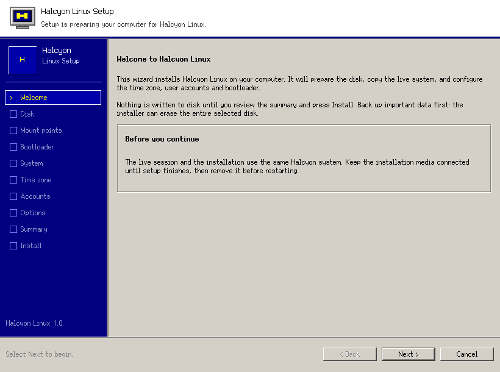
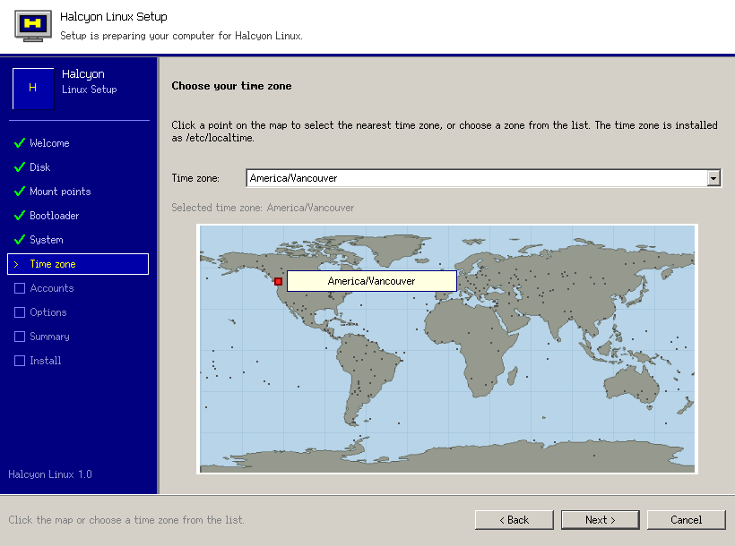

# Halcyon Setup

A Windows 95-style installation wizard for **Halcyon Linux**, written in
[LibGUI](https://github.com/jmalcolm137/libgui-wayland). It runs natively on
Wayland, builds on musl with Clang, and does not use libstdc++ or `std::`.

The wizard follows the installation and post-installation steps in the
[Chimera Linux handbook](https://chimera-linux.org/docs/). It can replace an
entire disk with a small boot partition plus bcachefs, or install onto an
existing partition layout with mount points chosen by the user.





## Features

- **Windows 95-style chrome**: navy step sidebar, beveled gray panels, classic
  Next / Back / Cancel navigation, and the Redmond theme from LibGUI.
- **Whole-device default**: pick a disk and let setup create the layout. UEFI
  systems get a 2 GiB FAT32 partition mounted at `/boot` (also the ESP), and
  the rest of the device is formatted as bcachefs and mounted at `/`. The
  summary names the exact device that will be erased.
- **Custom partitioning**: a partition table with per-partition mount points
  (`/`, `/boot`, `/boot/efi`, `/home`, swap, ...), filesystem and format
  controls, plus a **Partition Editor...** button that launches SParted's
  `PartitionEditor`.
- **Bootloader choice**: Limine (the Halcyon default) or GRUB, with the
  handling appropriate for UEFI and legacy BIOS.
- **Desktop choice**: install the Serenity Desktop Environment or leave a
  console-only system. `uutils-coreutils`, `bcachefs-tools`, `ckms` and the
  bcachefs/Broadcom CKMS sources are installed regardless of the choice. The
  precompiled live-session modules are removed from the target; the modules
  are built for the target kernel during initramfs creation.
- **Root password** and an arbitrary number of normal user accounts, including
  the `wheel`, `kvm` and `plugdev` groups.
- **Clickable world map** for the time zone. The map is equirectangular
  Natural Earth data; clicking it selects the nearest IANA zone from the
  system time-zone database. A combo box is available for exact selection.
- **Post-install configuration** from the handbook: hostname, `/etc/hosts`,
  time zone, hardware-clock mode, keyboard layout, fstab generation,
  initramfs creation with the CKMS-built bcachefs and Broadcom modules,
  `/etc/shells` regeneration, `base-live` removal, optional package updates,
  and enabling syslog-ng, NetworkManager and chrony.
- **Apple T2 support:** the x86_64 image uses `linux-halcyon`, keeps the
  Apple T2 Wi-Fi firmware, and offers optional `t2fanrd` fan control and
  `tiny-dfr` Touch Bar support in the Options page.
- **Installation log** with progress, and a finish page telling the user to
  remove the media before rebooting.

## Requirements

The application is built against the LibGUI host build distributed by the
`serenity-lagom` package in cports. It needs:

- `serenity-lagom` (LibGUI, LibGfx, LibCore, LibTimeZone resources)
- `bcachefs-tools`
- `util-linux` (`lsblk`, `sfdisk`, `wipefs`, `blkid`, `mount`)
- `parted`, `dosfstools`, `e2fsprogs`, `btrfs-progs`, `xfsprogs`, `f2fs-tools`,
  `exfatprogs`, `ntfs-3g` (filesystem creation)
- `chimera-install-scripts` (`chimera-bootstrap`, `chimera-chroot`, `genfstab`)
- `limine`, `grub-x86_64-efi`, `grub-i386-pc`
- `shadow` (`useradd`, `usermod`, `chpasswd`), `tzdb`, `kmod`, `polkit`
  (`pkexec`)
- `sparted` for the Partition Editor button

The live ISO already contains these packages.

## Building

From a checkout with the sibling `libgui-wayland` build tree:

```sh
make
make test          # plan generation and validation, no root needed
./scripts/run.sh --demo
```

To build with the cports/serenity-lagom installation, or in the cports
package build:

```sh
make LAGOM=/usr/lib/sde SERENITY=/usr/lib/sde/framework/serenity
```

The source is C++26, compiled with `-fno-exceptions`. It uses AK types and
SerenityOS conventions, so it builds with Clang on musl against libc++ without
touching libstdc++.

## Running

The installer needs root because it writes partition tables and mounts
filesystems. The installed desktop entry calls a wrapper that uses `pkexec` and
preserves the Wayland session environment:

```sh
sudo ./build/halcyon-setup
```

On the live ISO, use the **Install Halcyon Linux** desktop icon or run
`halcyon-setup` from the SDE Terminal. The launcher resolves the compositor's
`sde` socket even when the session exports a stale `WAYLAND_DISPLAY`, and the
live PolicyKit rule allows the active local user to elevate without an agent.

For development without root, use `--demo`; it uses two synthetic disks and
never writes to the system:

```sh
./scripts/run.sh --demo
```

Useful non-GUI commands:

```sh
./build/halcyon-setup --list-devices
./build/halcyon-setup --dump-plan /dev/nvme0n1
```

## Installation flow

1. **Welcome** — explains that nothing is written until the summary.
2. **Disk** — selected device, firmware type, data-loss confirmation, the
   exact whole-device layout preview, and Partition Editor / Refresh buttons.
3. **Mount points** — the whole-device layout is shown here as well; in custom
   mode every partition gets a mount point, filesystem and format choice.
4. **Bootloader** — Limine or GRUB.
5. **System** — hostname, keyboard layout and hardware clock.
6. **Time zone** — click the world map or pick an IANA zone.
7. **Accounts** — root password and user accounts.
8. **Desktop** — install the Serenity Desktop Environment or leave the target
   as a console-only system.
9. **Options** — post-installation services and update choices.
10. **Summary** — final review and confirmation.
11. **Install** — progress and a live log.
12. **Finished** — remove the media and restart.

The backend performs the handbook's sequence: wipe and partition (whole-device
mode), create filesystems, mount the target, `chimera-bootstrap -l`, ensure
`uutils-coreutils`, `bcachefs-tools`, `ckms` and the bcachefs/Broadcom CKMS
sources are installed, add or remove the SDE, configure the system through
`chimera-chroot`, generate `/etc/fstab`, create users and passwords, enable
services, regenerate `/etc/shells`, build the kernel modules with CKMS, run
`update-initramfs -c -k all`, install the bootloader, and unmount everything
even on failure.

## Packaging and the live ISO

`packaging/halcyon-core/halcyon-setup/template.py` is the cports recipe for the
`halcyon-core` repository. It installs:

- `/usr/lib/sde/bin/halcyon-setup.real` — the binary
- `/usr/bin/halcyon-setup` — the `pkexec` wrapper
- `/usr/share/applications/halcyon-setup.desktop`
- `/etc/skel/Desktop/Install Halcyon Linux` — an executable live-session
  desktop launcher
- icons and `/usr/share/halcyon-setup/world-map.png`

After tagging a release, set `_commit` and `sha256` in the recipe. The Halcyon
live image should add `halcyon-setup` to its `sde` package list; the desktop
link is copied into the `anon` user's home by `useradd -m` from `/etc/skel`.

## Notes and limitations

- The whole-device default uses a FAT32 `/boot` partition on both UEFI and
  BIOS. UEFI needs the ESP; the bootloaders used here read the kernel from the
  FAT partition, not from bcachefs.
- A separate `/usr` is rejected because Chimera and Halcyon are merged-/usr
  systems.
- Custom layouts must provide `/boot` for Limine, and UEFI needs a FAT32 ESP at
  `/boot` or `/boot/efi`.
- Disk encryption, LVM and ZFS are handled by creating the layout in Partition
  Editor first; the wizard installs onto the resulting partitions.
- The screenshot in `docs/` was captured with `--demo` under the headless
  compositor; it uses synthetic disks.

## License

BSD-2-Clause. The world map is rendered from public-domain Natural Earth data;
see `res/world-map.README`.
